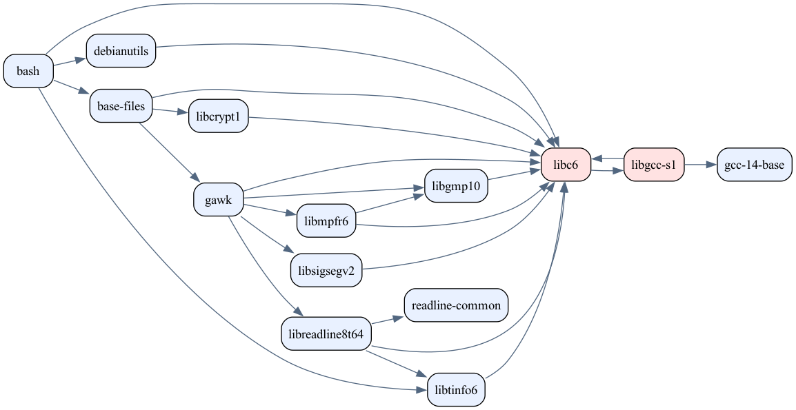

# Визуализация графа зависимостей Ubuntu

Практическая работа № 2, вариант № 5.

**Автор:** Григорьянц А. Г.

**Группа:** ИКБО-65-25.

## Описание проекта

Программа предназначена для анализа и визуализации
зависимостей программных пакетов Ubuntu (apt).

Проект реализуется на Python в пять этапов.

Основные возможности итоговой программы:

- Получение зависимостей пакетов Ubuntu.
- Построение графа зависимостей.
- Рекурсивный обход графа алгоритмом DFS.
- Обработка циклических зависимостей.
- Поддержка тестового режима.
- Определение порядка загрузки зависимостей.
- Формирование Mermaid-диаграмм.
- Создание изображений PNG.

## Этап 1. Конфигурация

Создано консольное приложение с аргументами:

- `--package` — имя анализируемого пакета.
- `--repository` — адрес или путь к репозиторию.
- `--test-mode` — включение тестового режима.
- `--output` — путь к выходному PNG-файлу.

Программа проверяет параметры и выводит их
в формате ключ-значение.

На первом этапе реальные зависимости ещё
не загружаются.

## Требования к окружению

- Python 3.10 или новее.
- Git.
- macOS или совместимая операционная система.

Сторонние Python-библиотеки пока не требуются.

## Запуск

Обычный режим:

~~~bash
./run.sh \
  --package bash \
  --repository https://archive.ubuntu.com/ubuntu \
  --output output/graph.png
~~~

Тестовый режим:

~~~bash
./run.sh \
  --package A \
  --repository examples/repositories/simple.txt \
  --test-mode \
  --output output/graph.png
~~~

Справка:

~~~bash
./run.sh --help
~~~

## Обработка ошибок

Проверяются:

- Наличие обязательных аргументов.
- Правильность имени пакета.
- Формат адреса репозитория.
- Существование тестового файла.
- Расширение выходного изображения.
- Наличие выходной директории.

## Тестирование

Запуск автоматических тестов:

~~~bash
PYTHONPATH=src python3 -m unittest discover -s tests -v
~~~

На первом этапе реализовано 10 тестов.

## Тестовый репозиторий

Файл `examples/repositories/simple.txt`:

~~~text
A: B C
B: D
C: D
D:
~~~

Этот набор будет использоваться при проверке
алгоритма обхода графа на следующих этапах.

## История разработки

Этапы фиксируются отдельными Git-коммитами
с тегами `stage-1` — `stage-5`.

## Результаты визуализации

Генерируемые изображения будут сохраняться
в директории `output/`.

Эта директория исключена из Git.

## Этап 2. Получение зависимостей Ubuntu

Реализована загрузка индекса пакетов Ubuntu (apt)
и самостоятельное извлечение прямых зависимостей.

Используется репозиторий Ubuntu 24.04 LTS (noble),
компонент main, архитектура amd64.

Для загрузки метаданных используются стандартные
библиотеки Python:

- `urllib.request` — загрузка данных по HTTPS;
- `lzma` — распаковка файлов Packages.xz;
- `gzip` — распаковка файлов Packages.gz.

Сторонние библиотеки для получения зависимостей
и менеджер пакетов apt не используются.

### Структура метаданных

Программа обрабатывает записи формата Debian
Packages, содержащие поля:

- `Package` — название пакета;
- `Version` — версия пакета;
- `Depends` — обычные прямые зависимости;
- `Pre-Depends` — предварительные зависимости.

Альтернативы и ограничения версий на данном
этапе сохраняются в исходном текстовом виде.

### Реализованные функции

В модуле `repository.py`:

- `index_url()` — формирование адреса индекса;
- `download_index()` — загрузка и распаковка;
- `read_fields()` — разбор полей одного пакета;
- `parse_index()` — разбор всех записей;
- `direct_dependencies()` — прямые зависимости.

Ошибки обрабатываются через `RepositoryError`.

### Пример запуска этапа 2

~~~bash
./run.sh \
  --package bash \
  --repository https://archive.ubuntu.com/ubuntu \
  --output output/graph.png
~~~

Программа показывает версию пакета и список
его прямых зависимостей.

Вместо корневого адреса репозитория также
можно передать прямой URL файла Packages,
Packages.gz или Packages.xz.

На этапе 2 файл PNG ещё не создаётся.
Визуализация будет реализована на этапе 5.

### Обработка ошибок

Предусмотрены проверки:

- недоступного репозитория;
- повреждённого сжатого индекса;
- неправильной кодировки данных;
- некорректных полей метаданных;
- отсутствующего пакета;
- пустого индекса.

### Автоматические тесты

Всего реализовано 27 тестов:

- 10 тестов конфигурации первого этапа;
- 17 тестов обработки репозитория второго этапа.

Запуск:

~~~bash
PYTHONPATH=src python3 -m unittest discover -s tests -v
~~~

Для проверки загрузки используются mock-объекты,
поэтому автоматические тесты не требуют интернета.

Тестовый режим построения графа будет добавлен
на этапе 3.

## Этап 3. Построение графа зависимостей

На третьем этапе реализован рекурсивный алгоритм
обхода графа в глубину (DFS).

Программа строит граф прямых и транзитивных
зависимостей пакета Ubuntu.

### Алгоритм DFS

Для обхода используются:

- `visited` — обработанные пакеты;
- `stack` — текущий путь рекурсивного обхода;
- `result` — граф зависимостей;
- `cycles` — обнаруженные циклы.

Каждый пакет обрабатывается только один раз.
При обнаружении цикла рекурсия по этому пути
прекращается.

### Виртуальные пакеты

Добавлена обработка поля `Provides`.

Программа находит поставщиков виртуальных
пакетов и использует их при построении графа.

Если доступно несколько поставщиков,
выбирается первый по алфавиту.

Проверка версионных ограничений и полная
имитация разрешения зависимостей apt
пока не реализованы.

### Запуск с настоящим репозиторием

~~~bash
./run.sh \
  --package bash \
  --repository https://archive.ubuntu.com/ubuntu \
  --output output/graph.png
~~~

### Тестовый режим

Граф без циклов:

~~~bash
./run.sh \
  --package A \
  --repository examples/repositories/simple.txt \
  --test-mode \
  --output output/graph.png
~~~

Граф с циклом:

~~~bash
./run.sh \
  --package A \
  --repository examples/repositories/cycle.txt \
  --test-mode \
  --output output/graph.png
~~~

Пример цикла:

A -> B -> C -> A

На третьем этапе граф выводится в терминал.
Создание PNG будет реализовано на этапе 5.

### Тестирование

Добавлены тесты разбора тестовых репозиториев,
DFS, циклических и виртуальных зависимостей.

Общее количество автоматических тестов — 43.

Запуск:

~~~bash
PYTHONPATH=src python3 -m unittest discover -s tests -v
~~~

## Этап 4. Порядок обработки зависимостей

На четвёртом этапе реализовано определение
порядка обработки зависимостей Ubuntu.

### Алгоритм

В модуле `order.py` используется алгоритм
Тарьяна для поиска компонент сильной связности.

Алгоритм:

- находит циклически связанные пакеты;
- объединяет циклические пакеты в группы;
- определяет порядок групп с учётом зависимостей;
- обрабатывает общие зависимости без повторений.

Зависимости располагаются раньше пакетов,
которые от них зависят.

### Пример без циклов

Исходный граф:

A: B C
B: D
C: D
D:

Результат:

D -> B -> C -> A

### Пример с циклом

A: B
B: C
C: A

Результат:

[A, B, C]

Циклические пакеты объединяются в одну группу.

### Реальный репозиторий Ubuntu

Пример запуска:

~~~bash
./run.sh \
  --package bash \
  --repository https://archive.ubuntu.com/ubuntu \
  --output output/graph.png
~~~

Программа выводит граф зависимостей,
циклические группы и порядок их обработки.

Полученный порядок не является точной
последовательностью установки apt.

### Сравнение с apt

Для проверки используется GitHub Actions
с окружением Ubuntu 24.04.

Выполняются команды:

~~~bash
sudo apt-get update -qq
apt-cache policy bash
apt-cache depends bash
~~~

Сравниваются непосредственные зависимости.
Алгоритм apt дополнительно учитывает версии,
альтернативы и другие правила установки.

### Автоматические тесты

Реализовано 51 автоматическое тестирование
функций первых четырёх этапов.

Запуск:

~~~bash
PYTHONPATH=src python3 -m unittest discover -s tests -v
~~~

### Результаты проверки с apt

Сравнение выполнено через GitHub Actions
на Ubuntu 24.04 LTS (amd64).

Проверяемый пакет: bash
Версия: 5.2.21-2ubuntu4

Результаты:

| Зависимость | Тип | Совпадение |
|---|---|---|
| libc6 | Pre-Depends | Да |
| libtinfo6 | Pre-Depends | Да |
| base-files | Depends | Да |
| debianutils | Depends | Да |

Все четыре непосредственные обязательные
зависимости совпали с данными apt.

Дополнительные категории Recommends и Suggests
не включены в анализ.

Программа формирует порядок групп зависимостей,
но не заменяет полноценный алгоритм apt.
Проверка версионных ограничений и разрешение
конфликтов пакетов не реализованы.

GitHub Actions: Compare dependencies with apt.
Результат: Success.

## Этап 5. Визуализация графа зависимостей

На пятом этапе реализовано создание графического
изображения зависимостей Ubuntu в формате PNG.

Для визуализации используется Graphviz.

### Принцип работы

Модуль `visualize.py` получает готовый граф
зависимостей и передаёт его программе `dot`.

На изображении:

- каждый пакет представлен отдельным узлом;
- стрелки показывают направление зависимости;
- обычные пакеты выделяются голубым цветом;
- пакеты, участвующие в циклах, выделяются
  светло-красным цветом.

Стрелка A -> B означает, что пакет A зависит
от пакета B.

### Установка Graphviz

На macOS:

~~~bash
brew install graphviz
~~~

Проверка:

~~~bash
dot -V
~~~

### Создание графа Ubuntu

~~~bash
./run.sh \
  --package bash \
  --repository https://archive.ubuntu.com/ubuntu \
  --output output/graph.png
~~~

После выполнения создаётся PNG-файл,
который можно открыть командой:

~~~bash
open output/graph.png
~~~

### Граф реальных зависимостей bash

В графе показаны прямые и транзитивные
зависимости пакета bash.

Циклические зависимости libc6 и libgcc-s1
выделены светло-красным цветом.

### Автоматическое тестирование

Всего реализовано 60 автоматических тестов.

Проверяются:

- конфигурация приложения;
- чтение зависимостей Ubuntu;
- рекурсивный обход DFS;
- обнаружение циклов;
- определение порядка зависимостей;
- создание PNG через Graphviz;
- обработка ошибок визуализации.

Запуск всех тестов:

~~~bash
PYTHONPATH=src python3 -m unittest discover -s tests -v
~~~

Результат проверки: 60 tests, OK.

### Ограничения

Программа не устанавливает пакеты Ubuntu,
а анализирует и визуализирует зависимости.

Алгоритм не воспроизводит полностью
поведение пакетного менеджера apt.

Для использования Graphviz необходима
установленная программа dot.
